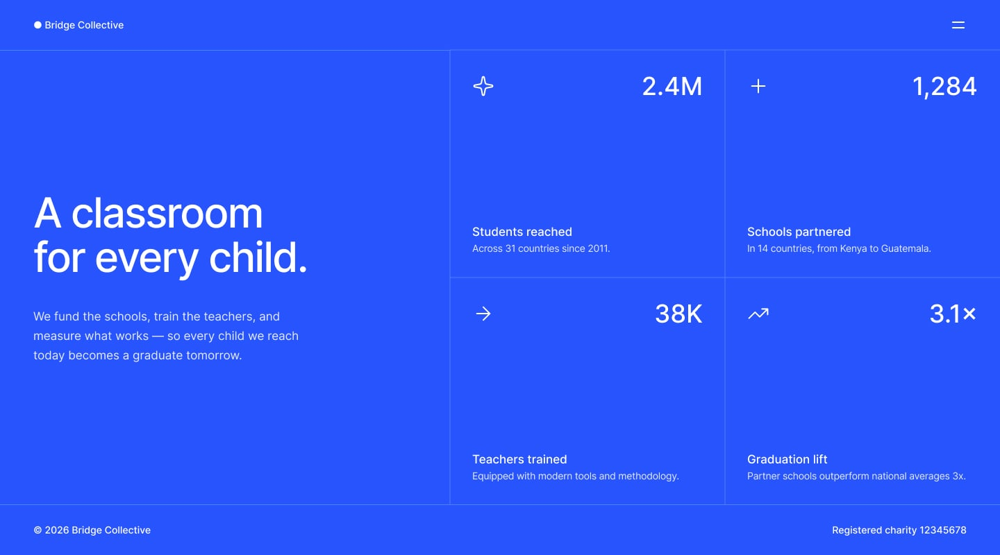
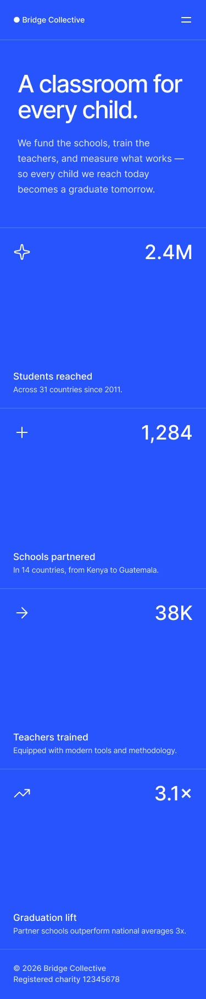
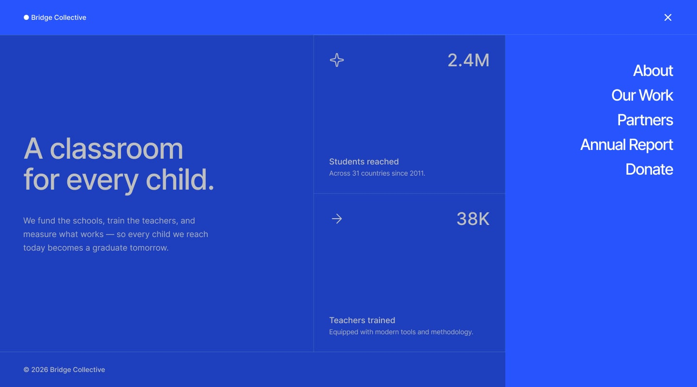
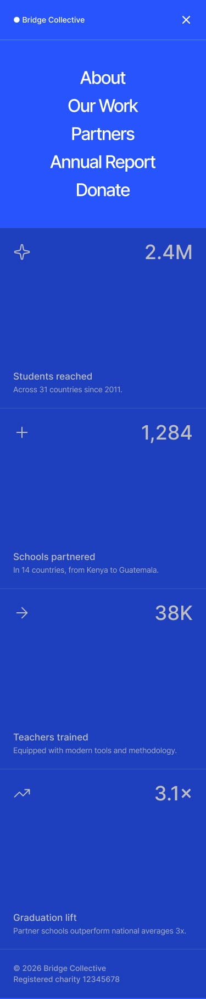

# Frontend Mentor – Grid landing page solution

A responsive landing page for "Bridge Collective", a fictional education charity, built for a [Frontend Mentor](https://www.frontendmentor.io) challenge.

## Overview

### The challenge

Users should be able to:

- View the optimal layout for the page depending on their device's screen size
- See hover states on the stat cards
- Open and close the navigation menu from the header
- Use the menu with a keyboard and screen reader

### Screenshots

| Desktop | Mobile |
| --- | --- |
|  |  |

| Menu open (desktop) | Menu open (mobile) |
| --- | --- |
|  |  |

## Built with

- [React 19](https://react.dev) + TypeScript
- [Vite](https://vite.dev) with the React Compiler
- Semantic HTML5 and plain CSS (custom properties, native nesting)
- CSS Grid and Flexbox
- Mobile-first workflow
- [Inter](https://rsms.me/inter/) variable font, self-hosted

## Getting started

```bash
npm install
npm run dev      # start the dev server
npm run build    # type-check and build to dist/
npm run preview  # serve the production build
npm run lint     # run ESLint
```

## Project structure

```
src/
├── App.tsx                 # page layout and menu open/close state
├── App.css                 # component and layout styles (BEM)
├── index.css               # @font-face, design tokens, reset
├── stats.ts                # typed stat card data
├── components/
│   ├── NavMenu.tsx         # navigation panel and dimmed overlay
│   └── StatCard.tsx        # single stat card
└── assets/                 # SVG icons
public/
└── fonts/inter/            # Inter variable font and its license
```

## What I learned

**Divider lines with `gap: 1px`.** The stats list's background is set to the divider color, and each card has the page background. The 1px grid gap shows through as a line between cards, and it works the same for one, two or four columns, so no border rules are needed.

**Aligning an overlay with grid columns.** On desktop the page is a three-column grid (`1.64fr 1fr 1fr`). The nav menu and overlay are placed in that same grid, so the menu panel lines up exactly with the last column of cards without hard-coded widths.

**Variable fonts need a weight range.** In `@font-face`, `font-weight` declares which weights the file contains. With `normal`, the browser treats the file as weight 400 only and can't render lighter weights. Declaring the range `100 900` unlocks every weight.

**An accessible menu toggle:**

- `aria-expanded` and `aria-controls` on the toggle button
- focus moves to the first link on open and back to the toggle on close
- Escape or a click on the overlay closes the menu
- `inert` on the content and footer keeps keyboard focus out of the dimmed page
- animations are disabled when the user prefers reduced motion

## Author

- Ulugbek Nazarov
